## Journal 01 - 09/21/2026 - Brainstorming and Planning
As a first step, my team (which as of right now consists of Nat, Olivia, Hanif, Nolan and myself) began by taking the time to look over the project that we were given. This is the  Game Design Education Software  with Pippin Barr, and has challenged us with creating an educational software that would allow someone with no coding experience to manipulate and create variations to a pre-existing simple game. 

As we were encouraged to begin the brainstorming period of the class, we opted to share a "Figjam" file where we began to jot down any ideas we had. Each with our colors, we laid out digital sticky notes with quickly-written thoughts on what a project like this could look like (without shying away from Figjam’s sticker options, of course).

Our Figjam board ended up being composed of multiple sections, which I will cover individually.

### Section 1 - Team
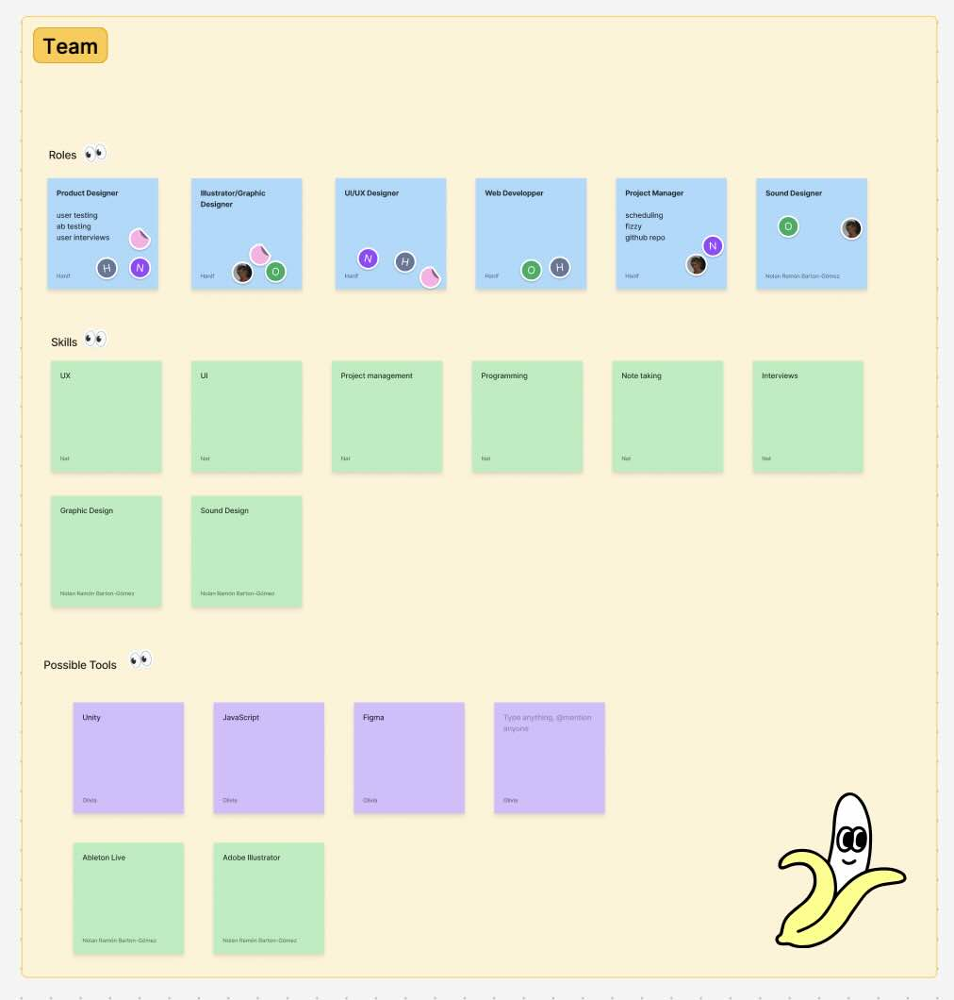

First we began by discussing our strengths and weaknesses as members, trying to decide who would most likely be taking on the roles in a project like this. At the same time, this also got us thinking about the types of work that would need to be done, and so we created sections that quickly listed the skills and tools we believed would be necessary for creating the software.

### Section 2 - “Output”
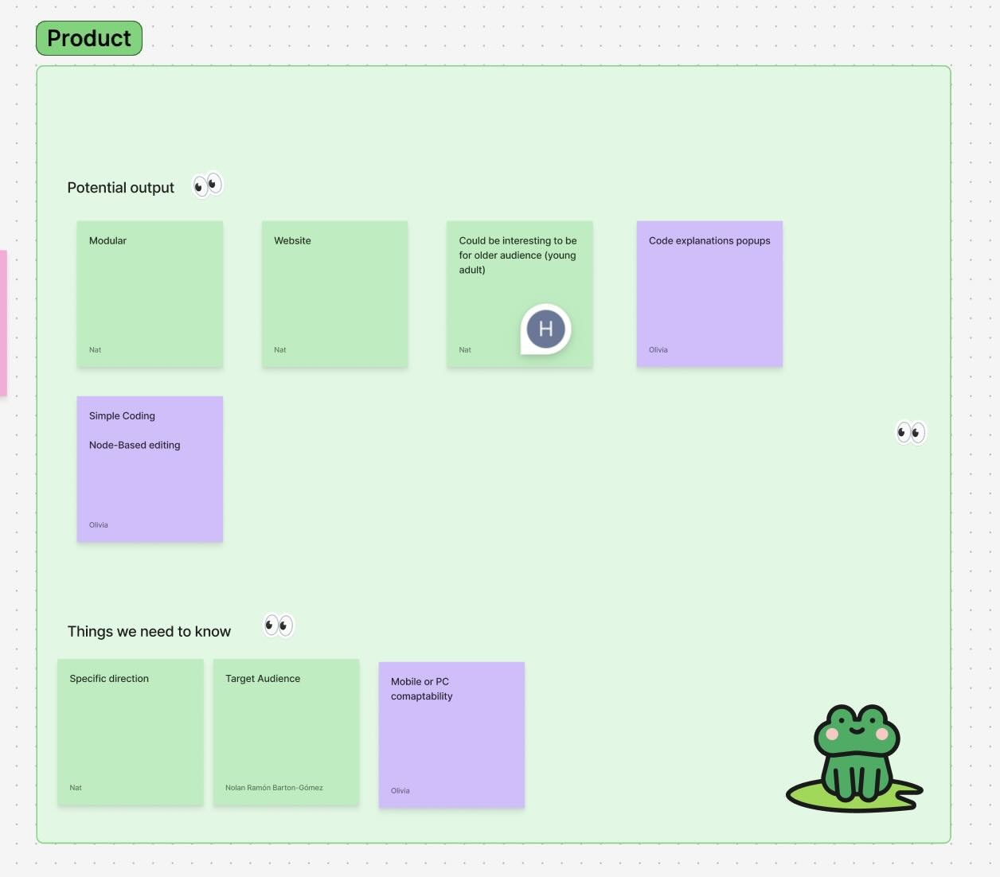

Once we got a vague idea of the type of project we’d be working on, we began deciding what we could possibly have as a final goal. As a team of five and with Pippin Barr’s suggestion for a final output seemingly being anything from an interactive Figma presentation to a working program, we decided that it would be more interesting to aim for the latter. With this came more questions than answers, however. Our main concern was that we still don’t know who our target audience is supposed to be, and this fact (that we can really only get from Pippin) will be a defining factor in which of the directions we finally go towards.

### Sections 3 - “Inspo”
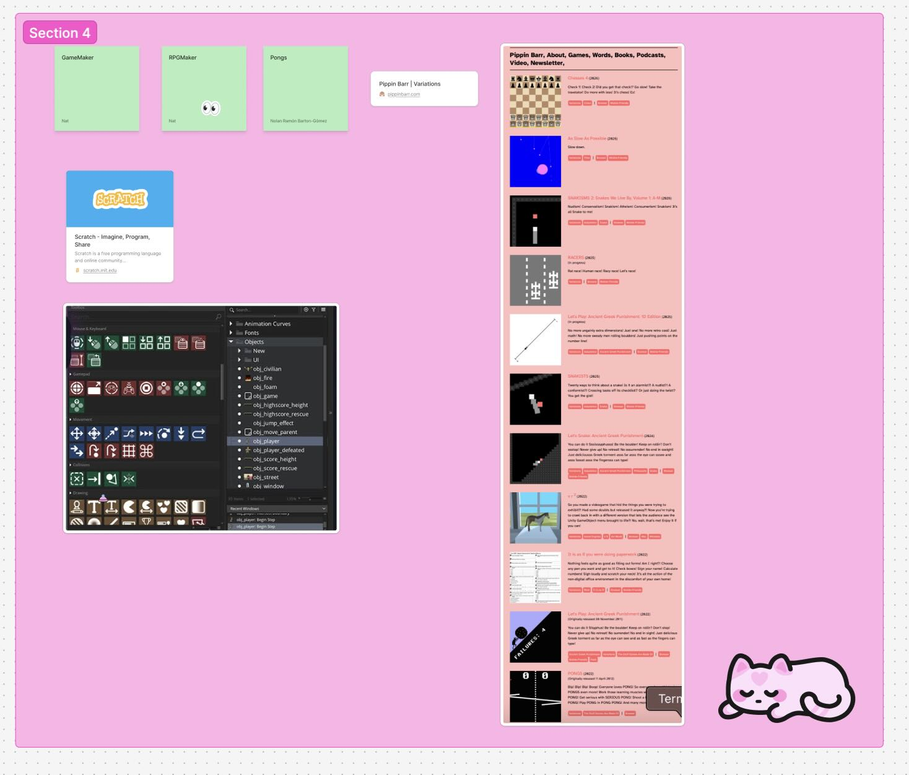

Despite us having many questions, we still continued discussing what a software of this sort could look like, and what inspirations we could use to begin problem solving. One of our teammembers, Hanif, mentioned “Scratch”; a game-building software aimed at a younger audience. Although “Scratch” is far more complex on its back-end than what we could probably achieve over the course of the class, we still decided that it would be a valuable reference for the type of software we are to produce.

Olivia brought up both gameMaker and RPG maker, which also aim at ‘simplifying’ game-making for beginners. Most interestingly is these software’s use of a sort of step-coding, which lets users visualize through images what they want to happen in their game (bottom left of image).

Finally, we also knew it would be important to reference Pippin’s own work, as he has an extensive portfolio featuring many ‘altered/varied’ versions of popular simple games.

### Section 4 - “Feedback”

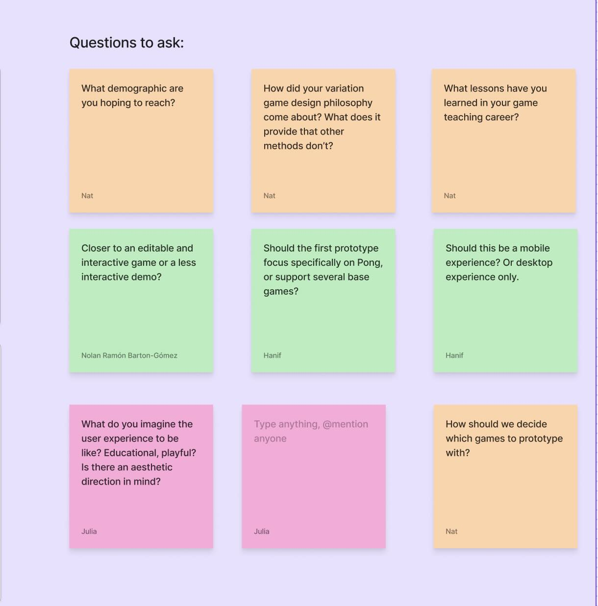

During the entire discussion, we made sure to take notes of which questions we wanted to ask our client when we saw him next week. We were mostly interested in the aforementioned “target audience” of the project, as well as some more personal questions that would allow us to hopefully better understand his design philosophy, and allow us to create something that aligns with it in return.

### Final Thoughts

After presenting, it was pointed out that we have a large advantage when approaching this project: all of us in the class learnt coding in an academic setting, and can use our experience of what we “wished we could have had” to help guide our choices. I’m looking forward to seeing how our varying skills and creative ideas shape this project!

## Journal 02 - 09/21/2026 - Ideation
### The First Client Meeting
Last week was our team’s first time meeting with Pippin Barr in order to begin discussing what his goals were for the projects, as well as his expectations. The conversation mainly focused on his philosophy on gaming, as the software we are supposed to develop is directly linked to the ideologies in the book he is working on titled Playing the Variation Game. 

He explained that the most important aspect of what we create has to be its ability to make the player think in an unconventional way. That is, it must allow players to approach game-making from an experimental, unconventional angle that separates itself from the usual rigidity that is learning to code. Preferably embracing the weird and wacky, the software will allow those to experiment with creating games, and variations of games, in order to experience the process of “Game-Making” without needing to code. In short, it is a wacky, experimental sort of software that puts the ‘game’ back into ‘game-making’.

### Ideation
After our meeting, we decided that as a group it would be best if we individually came up with our own designs, and then presented them to each other the week after. This would allow for all of us to come in with unique ideas that aren’t influenced by one another yet. 

As my own personal goal, I knew I wanted to really focus on the ‘unconventionality’ of the software, starting with the visuals. As of now, I believe that creating unique visuals will naturally lead into unique functionality. 

To do this, I wanted to start by breaking the standard rectangular space that most software assumes since, of course, our screens are rectangular. I thought, then, well is there anything that already does that? The answer I came up with was … yes! Early 2000-2010s window media/audio players were often wacky, strange shapes, but still maintained a level of functionality that allowed the user to use the button interface to play/stop/fastforward and sometimes even manipulate the audio further.

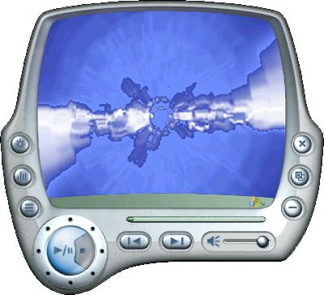
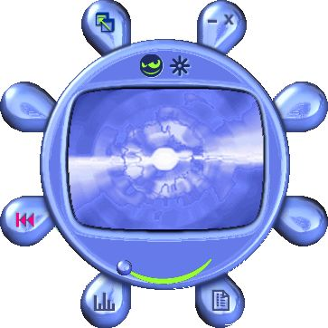
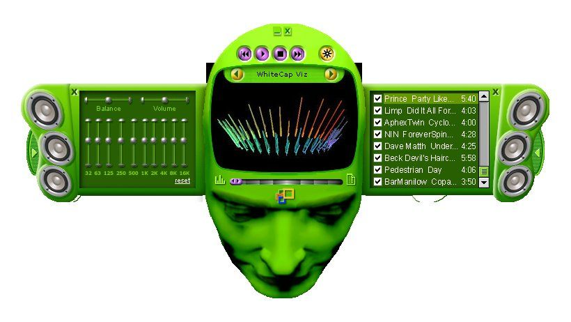

### Photo-bashes

With these ideas in mind, I continued by doing some photo-bashing. Without concentrating too much on the details, I wanted to create some quick ideas that would allow me to get a feeling for what we are designing.

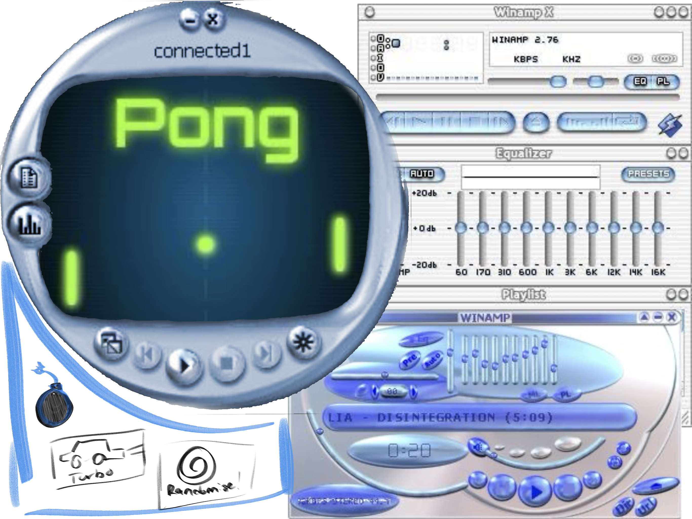
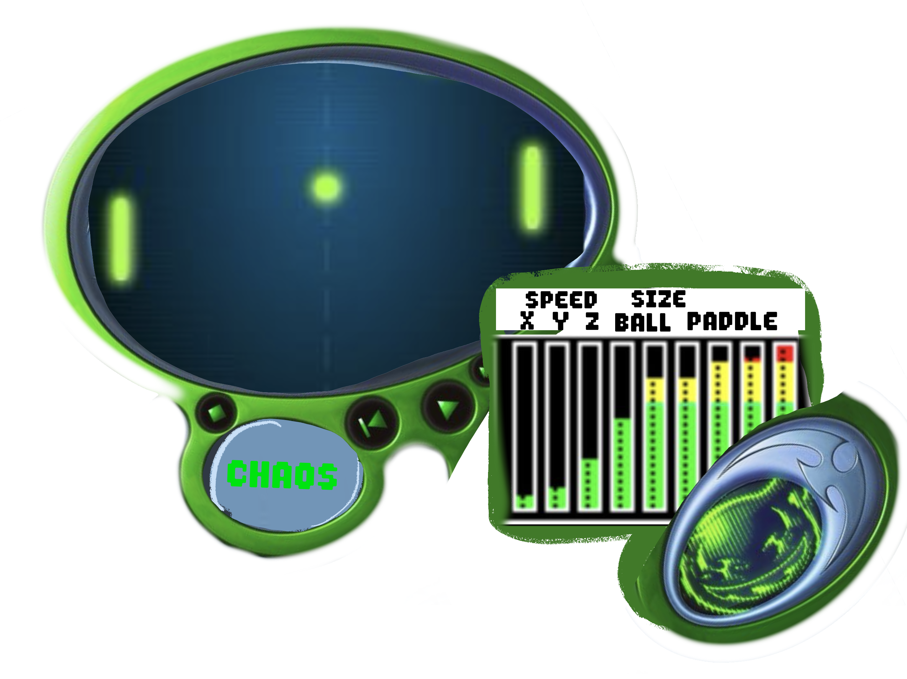

The various buttons and levers, while taken from photos of media players, would instead correspond to various attributes of the chosen game, and would theoretically vary depending on the game chosen. I also like the idea of some of the controls being obvious, but others being more ambiguous, such as the ‘chaos’ button in the second photo-bash, which imply an unexpected outcome. This would, in theory, force players to interact with the media out of curiosity, and create some surprising results, without worrying too much about making the game ‘good’.

## Journal 03 - 10/06/2026

### The Group Meeting + Meeting Notes
After the first milestone meeting last week, our team decided it would be essential to have a meeting where we decided on the next steps to take in the design of the software. We knew we needed several things in order to progress: A user flow, wireframe and a more solid grasp on the aesthetic direction we wished to take. 

In order to better organize ourselves, we added onto the shared Figjam file, agreeing to each share our work from the week there so that we could easily flip between each-others progress. We added a section here where we would take note of the discussions during our meetings, and where we would assign what cards would go to who on the Fizzy Kanban. 
Each member was assigned a task, as well as the responsibility to add to a shared 'Moodboard" that would be ongoing, where we are to add inspiration. For me, the results of this meeting was that I would be responsible for the visual pitches, going off of what we presented last week. We decided to stick to the wacky/unconventional design language. I was to work with Olivia on this, as we contributed the most last week to the brainstorming of the visual aspects.
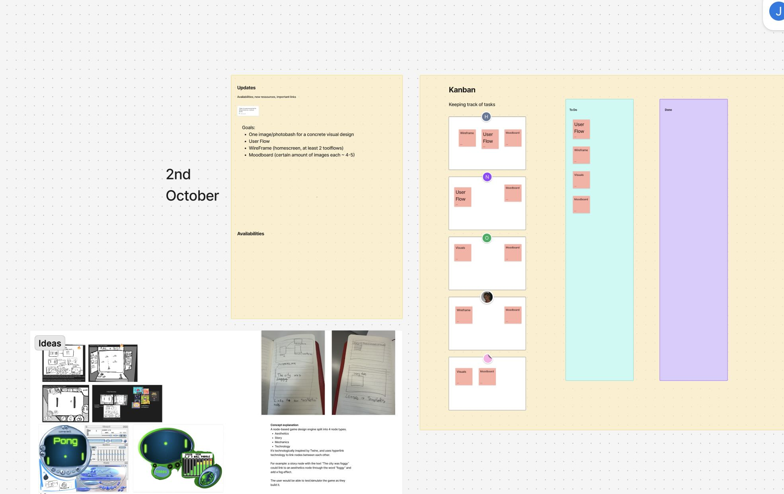
### The Moodboard
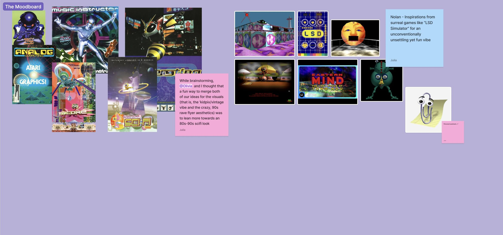
This is the aforemnetioned moodboard, where Olivia and I added some of the inspiration that we pulled from creating the visual pitches. As we looked over last weeks ideas, we found there was a possible overlap between our two designs, deciding to mix my "2000s audio player" inspirations with her "wacky retro" vibe, culminating into one design idea that would lean more towards a retro game look. This is what we explained in the images added onto the board. As you can see, some other images were also added by Nolan, instead suggesting leaning more into the surreal and possibly incoporating a 'digital assistant' sort of character.
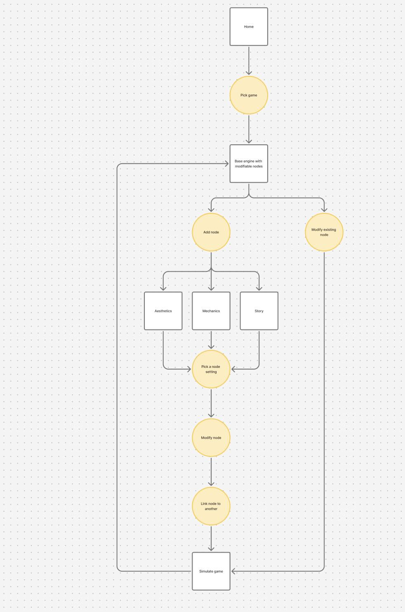
### Wireframe and user Flow
Nat was responsible for the above user flow, which was then handed over to Hanif, who worked largely on the wireframe. The two collaborated in order to have the two steps work well with one another and create a cohesive idea for /how/ this software would theoretically work interface wise.
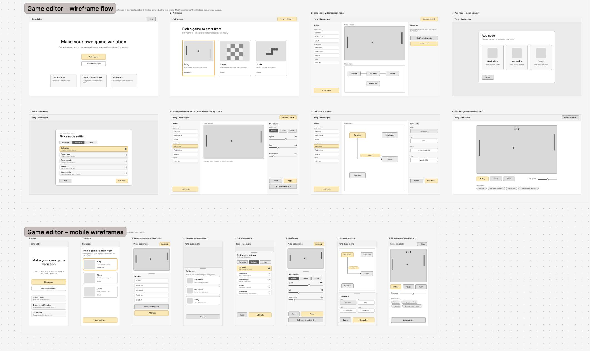
Above is the Wireframe made by Hanif.
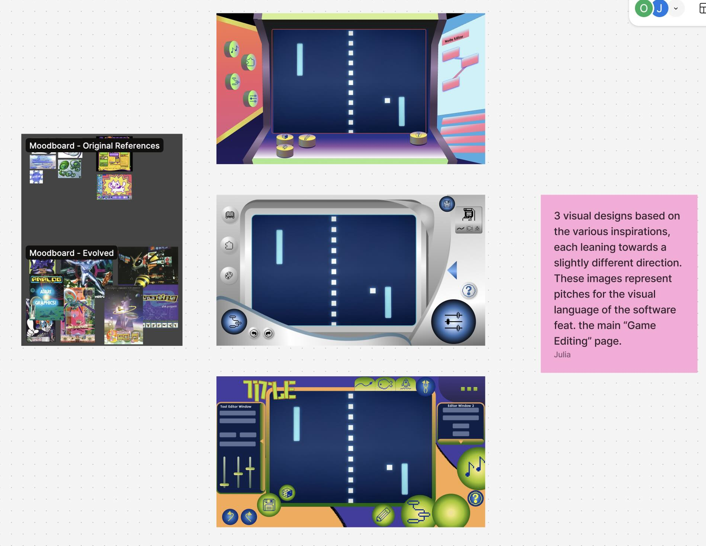
Finally, after looking at Hanif's wireframe and Nat's work ont the User Flow, Olivia and I worked on creating 3 varying visual pitches. For the designs, we focused on the 'main' page that the user would be using, that is to say the "game Editing" page. Referencing our other team member's work, we tried to imagine how these different tools and pages would be accessed while also pushing the imagery into an unconventional direction. Our first one leaning heavily into the aforementioned retro-game style, the second more into the original '2000s' style, and the third into the 'Kid-Pix' design that Pippin mentioned during our first meeting.

### Final Notes
Unfortunately, we were having a difficult time getting hold of Pippin, and had to continue with our design without his input. However, we are hoping to arrange two more meetings with him before the midterm. So far, the unconventional elements have been enjoyable to experiment with, and once the visual style is confirmed, it will be even more itneresting to start implementing some of the functionality.

## Journal 04 - 10/20/2026

### UI Design Shift

Since Olivia and I have done the UI designs and we've taken a look of the wireframe as a group, there was some changes in the artistic direction that we wished to go in. On one hand, we liked many of the 'wacky' aspects of the design pitches that Olivia and I had come up with, but ultimately it was decided that having so much visual clutter might only overwhelm the users. 
Despite this, it was also said that the designs, particularly the arcade-based one, was interesting due to its ability to evoke the sense of 'playing' a game while making one. This was one of the key points that Pippin had expressed: the software must bring the 'game' back into 'game-making'.
With this in mind, we decided to shift the artistic direction into one that was, as we described it, a nintendo-based UI that evoked the same fun as the old-style Nintendo UIs from the 2000s, but also included the same feeling of simplicity. Moreover, Pippin had expressed that the software/website is supposed to mainly be directed at his students. With the target audeience being roughly in our age group, we can confidently say that this sort of design language is nostalgic game-wise and will hopefully put the target audience into a 'game-mindset' as the look and feel of the website evokes these nostlagic feelings. 
After this conversation on the 7th of October, it was decided that as the others worked on an interactive wireframe, Olivia and I would work towards creating a new UI design. 
The results are shown below, and are based on the wireframe that was developed the week prior.
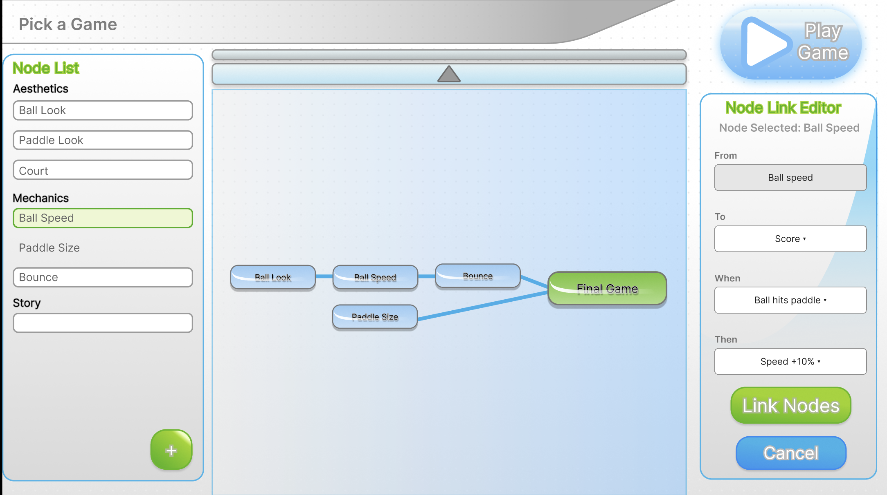
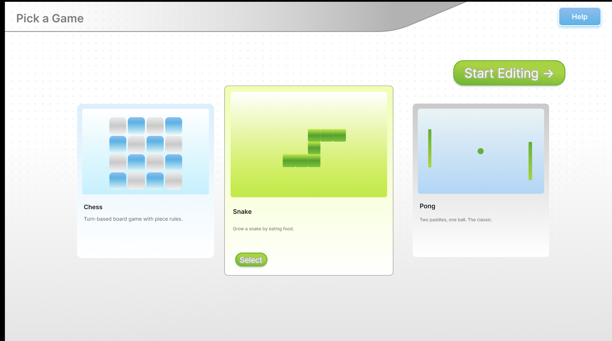
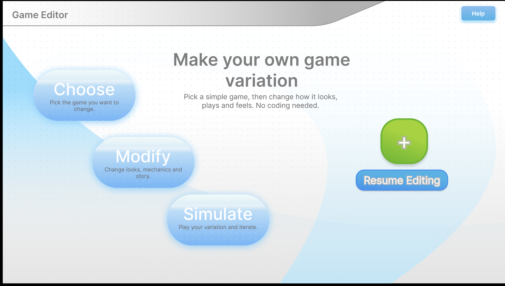
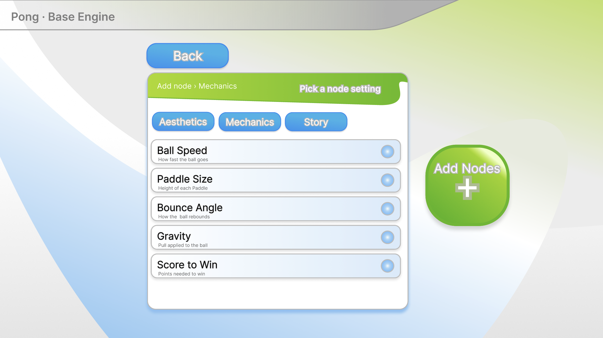
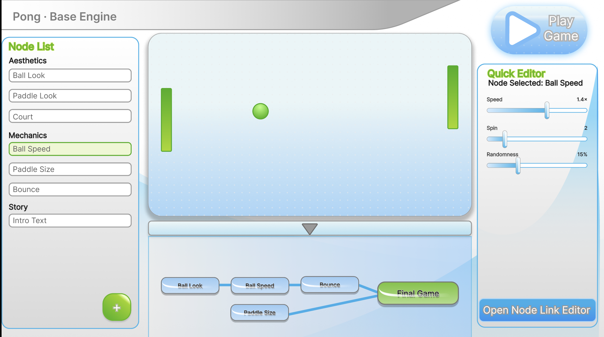

### Meeting with Pippin

On the 14th of October we finally had a meeting with Pippin, durng which we discussed the direction of the project and future expectations as we approach the midterm. Overall, Pippin gave us very positive feedback concerning the artistic direction of the project (which he agreed was an improvement from the original designs). He was also impressed by our idea of including node-based editing, saying that including this sort of editing opens up many more avenues for radical experimentation (our key-words, here!). 

However, he also reminded us that our choices in which tools we impliment and what we allow said tools to do will greatly affect the imaginations of the people using the software. Going off of this, Pippin offered many examples of books he recommended we give a quick look at, which could influence somwe of our decisions going forward and give us some new perspective in our creative process. He also recommended we take a look at existing game engines as reference.

### After the Meeting and Midterm Plans
After our meeting, we decided to divide the research amongst each of us, allowing each team member to choose a book + Game Engine to do some researh on so that the week of the 21st we can come together to discuss our findings. Personally, I chose to look at the "Game Feel" book by Steve Swink, and to analyze how Unreal Engine allows editing.

As for Midtern Plans, we decided that we wanted to have a video prototype done by the midtern meeting with Pippin (that is to say, the week of the 28th) which would feature a almost fully-finished Figma Prototype edited into video footage to visually shows what working in the software/website would look like. After this, or in parralel should we have the time, we also decided it would be beneficial to start on our 'playable protoype'. Moreover, we also decided that we want to have something to get user feedback from as soon as possible. For this, we will likely use a combination of the Figma protoype and the video prototype.

That's all for now!

## Journal 05 - 10/27/2026

### New Features and Figma Work
Continuing from where we left off, we knew that we needed to add more functionality to our Figma prototype if we wanted to demonstrate the full functionaltiy of our software during our video prototype. After some discussion, we knew we needed the following: A demonstration of the standard workflow, the "quick editor" functionality and, most importantly, the 'node' editor. The node editor, being one of the more foreign concepts introduced into this sort software, would need particualr attention in order for us to properly communicate it's full potential to our test users (and Pippin!). 
Moreover, Olivia reminded us that we also wanted to add a "randomize' button that would adjust all the sliders in the 'quick' editor to random variables for particualrly surprising results. She also added a 'draw' button that would allow the user to make marking on their game that could act as barriers or new items.
Hanif and I focused on adding the other aforementioned functionality, with Hanif focusing mostly on the demonstration of the node editor. I, on the other hand, rearranged some of the pages to streamline the user flow, and removed any button redundancies in the UI. Olivia and I were also resonosible for the stylization of some of the button interaction (Hanif worked on this equally), as well as some of the UI animations (such as the "rotating" effect when selecting a game).
The gif included shows the standard workflow, the node editor, quick editor and other features. It also shows the full interactability and stylization of the interactable elements.
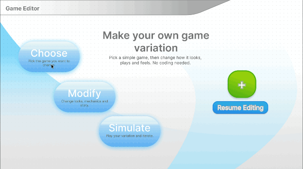
### The Video Prototype
Next, we began work on the video prototype, which would act as a sort of 'ad' of the concept, explaining quickly the ideas and potential of a program like this. Olivia and I worked on this, combining screen-recorded scenes from Figma with extra footage from After-Effects. We hope to present both of these prototypes to Pippin tomorrow (our midterm checkup!) in order to truly finalize the functionality and design. The hope is to also establish a scale for the final project outcome for the end of the semester.
The full video can be watched on [HERE](https://youtu.be/kcf4vYF23dc?si=tbGoQravt8feCUH6)
### Midterm Reflection and Moving Forward
Moving forward, I would like to get the video and figma prototypes to test users, in order to get more feedback before we move on to the next phase of the project. However, as of right now, it is difficult to know what that 'next phase' will be without Pippin's input. Of course, these questions will be answered tomorrow. As of right now, I feel quite satisfied with our ideas and our progress and would like to see the project evolve into a more complex one. As was mentioned in past journals, having something of a more close-to-concept interactable prototype would be interesting. This could entail having one of the games (probably pong) recreated with some of the editing capabilities in a P5 project. 

Next update will be after the midterm client meeting and leading up to our midterm presentation :)

## Journal 06 - 11/03/2026

### 10/28/2026 Midterm Meeting With Pippin

Last week we had our second update with Pippin, where we showed him our progress so far. This included the video prototype as well as the figma workflow that we have developed to this point. Overall, the feedback was largely positive. Pippin expressed an interest in the fact that we focused more on the visual and UI aspects of the project, which he explained was something he rarely did, and told us that these elements did, in fact, give the theoretical final product a strong identity and "feeling" that would contribute positively to the user experience. He also expressed an interest in what we presented mechanically, stating that the combination of sliders and node editing was the right direction to continue towards.

However, Pippin did also express some small criticisms or things he'd like to see explored more. Firstly, he mentioned a thought he had concerning the UI design, saying "Spending time looking at the Wii-inspired UI does make me wish/wonder about it being less controlled and "proper" - no need to tear it down or anything, but I find myself wondering what a more chaotic interface could look like and whether that might encourage playfulness in ways a more classy/calm UI might not? Something to reflect on". 

The reason we had gone with this UI design was because of the fact that this sort of 'clean' design language does, in fact, register as 'playful' and 'creative' due to our generation's nostalgia and familiarity with Nintendo's older work. However, it is interesting to see this design langiage interpeted differently from someone of a previous generation. Therefore, we will probably have to invest a little bit more time into nudging the UI into a direction that is 'less clean'. One option I mentioned was to potentially 'break up' the monotony of the shapes in the UI by having the parts of the UI broken up into irregular shapes, like the image below.
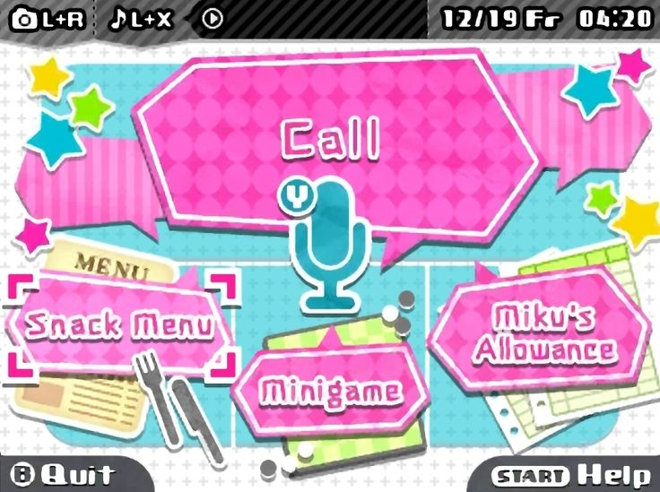

I also do like the idea of potentially introdicuing a "mixed media" into the UI. This wouldn't be a comeplte overhaul, but instead a few small adjustments that might make a big difference.

Secondly, Pippin also explained that, since we have developed the flow and 'experience' to a good degree, it would be nice if we could start experimenting with the technical side a little but more. Olivia and I decided to take on this task since the others expressed less confidence in using P5. During the meeting, Pippin demonstrated a small bit of code that we could begin with, and some of the experimentation that he would like to see. Although he doesn;t expect for us to even include the node editing at all (which I agree, would probably extend beyond the scope of the class) including a P5 project where one can test the 'essence' of the program would be favorable.

We will be developing off of something the client and the team worked on together during the meeting. It is really jsut a few sliders that alter parameters of the game, but even just these parameters allow for some major changes to "Pong". Olivia and I will add more editable variables and will add simialr visuals for it to look cohesive with out Figma prototype.

### Midterm Presentation

So far, we have several things we'd liek to go over for the presentation. Of course there is the mandatory topics we will have to go over, but we will also be shpwing our video prototype and our Figma protoype in order to hopefully get feedback from the audience. Our goal is to have the technical prototype done for next week, when we will have another meeting with Pippin.

